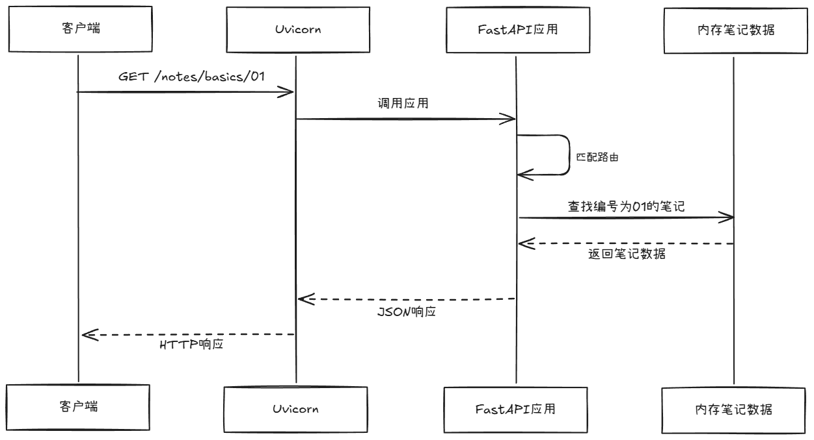

# 第 01 篇｜开始之前：API、HTTP 与 FastAPI 到底是什么

> 示例代码：code/article01

> 验证环境：Windows；Python 3.13.5、FastAPI 0.115.0、Starlette 0.38.6、Pydantic 2.14.1、Uvicorn 0.30.6、HTTPX 0.28.1  

---

## 前言
第一次接触 FastAPI，代码里很快就会出现路由、请求、响应、状态码、JSON、Uvicorn 等词。它们看起来都和接口有关，却不是同一件事。若把它们混成一团，遇到报错时就很难判断：是请求写错了、数据不存在、Python 代码有问题，还是服务根本没有启动？

本篇从读取一条笔记这个小例子出发，先解释 API、HTTP 和 FastAPI 的关系，再拆开一次请求和响应。读完后，你应该能看懂一个简单的 HTTP 请求，理解常见状态码的作用，并说清 FastAPI 与 Uvicorn 的分工。
## 1. 先用一条笔记理解 API
API 是 Application Programming Interface 的缩写，通常译作“**应用程序编程接口**”。它是一组让程序之间能够按约定交换信息、使用功能的入口。

在 Web 开发中，本专栏所说的 API，主要指通过 HTTP 提供的 Web API。

假设服务里有一条编号为 01 的笔记。客户端想读取它，可以发送下面这个 HTTP/1.1 风格的请求：
```http
GET /notes/basics/01 HTTP/1.1
Host: 127.0.0.1:8000
Accept: application/json
```
这几行的意思分别表示：
1. **GET** ：**HTTP 请求方法**，表示客户端希望读取资源。
2. **/notes/basics/01** ：**请求路径**，表示访问 notes 资源中编号为 01 的笔记。
3. **HTTP/1.1**： 表示这次请求使用 **HTTP/1.1 协议格式**。
4. **Host: 127.0.0.1:8000** ：表示请求发送给本机的 8000 端口。
5. **Accept: application/json** ：表示客户端希望接收 JSON 格式的响应。它是请求头，不是请求正文。

对应的成功响应是：
~~~http
HTTP/1.1 200 OK
date: Fri, 06 Nov 2026 11:05:22 GMT
server: uvicorn
content-length: 34
content-type: application/json

{"id":"01","title":"开始之前"}
~~~
这部分是服务器返回给客户端的响应。逐行看：
1. **HTTP/1.1 200 OK** ：表示服务器使用 HTTP/1.1 返回响应，状态码 200 表示请求成功，OK 是对这个状态的文字说明。
2. **date**：表示服务器生成这次响应的时间。这里使用 GMT 时间，实际时间会随着每次请求变化。
3. **server: uvicorn**： 表示当前网络请求由 Uvicorn 接收和返回。
4. **content-length**: 34 表示响应正文占用 34 个字节。它不是固定值，响应内容变化时长度也会变化。
5. **content-type: application/json** 表示响应正文采用 JSON 格式。
6. **{"id":"01","title":"开始之前"}** 是响应正文中的 JSON 对象，包含笔记编号和标题。

这里发生的事情可以概括为：客户端说明自己要读取什么，服务端按约定处理，并把结果返回。客户端可以是浏览器、命令行工具，也可以是另一个程序。它不需要知道服务端具体使用 Python 字典还是数据库保存笔记，只需要遵守 API 约定。

> [tips] 
> API、HTTP、JSON 和 FastAPI 不是同义词。API 是接口约定；
> **HTTP 是本例中客户端和服务端交换消息的协议**；
> **JSON 是常见的数据表示格式**；
> **FastAPI 是帮助我们用 Python 构建 Web API的框架**。

如图把刚才的一来一回以时序图的方式呈现：


如图所示，整个过程从上往下展开：客户端首先发送 GET /notes/basics/01 请求；Uvicorn 接收请求后，将它交给 FastAPI 应用。FastAPI 根据请求方法和路径找到对应的处理函数，并对路径中的笔记编号解析。

处理函数随后从内存中的 Python 字典里查找笔记。找到后，FastAPI 将笔记数据转换为 JSON 响应，再由 Uvicorn 发送给客户端。图中的实线箭头表示请求或调用，虚线箭头表示结果返回。这里的“内存笔记数据”就是应用中的 Python 字典，并不是独立运行的数据库服务。

通过这个例子，我们可以先建立一个认识：**调用 API，就是调用方按照约定发出请求，由提供接口的程序处理并返回结果**。 
本例的约定包括读取笔记的方法、路径，以及返回数据的格式。

## 2. HTTP 请求：客户端想让服务做什么

第 1 节建立了整体印象，下面进一步理解这些字段为什么要分开放。

**HTTP**（Hypertext Transfer Protocol，超文本传输协议）规定了客户端和服务端如何交换请求与响应。入门时可以先把请求看成四部分：方法、目标 URL、请求头，以及在需要时附带的请求体。

| 部分 | 示例 | 作用 |
| --- | --- | --- |
| 方法 | GET | 表达本次操作的意图 |
| URL | /notes/basics/01 | 指出请求目标 |
| 请求头 | Accept: application/json | 提供媒体类型等请求信息 |
| 请求体 | JSON 数据 | 在需要时提交数据 |

### 2.1 方法

方法用于明确**对资源做何种操作**。

常用 HTTP 方法包括：

- GET：读取资源。
- POST：提交数据，常用于创建资源或发起操作。
- PUT：按约定替换资源表示。
- PATCH：按约定局部修改资源。
- DELETE：删除资源。

### 2.2 URL
URL 用于明确**请求发往哪里**。

完整 URL 可能是：

~~~text
http://127.0.0.1:8000/notes/basics/01
~~~

其中，`http` 是协议方案，`127.0.0.1` 是主机地址，`8000` 是端口，`/notes/basics/01` 是路径。

地址和端口帮助客户端找到服务，路径帮助应用确定目标资源。

URL 还可以在问号后携带查询参数，例如 `/notes?limit=10` 可以约定为“最多读取 10 条笔记”。这只是格式示意，本篇尚未实现列表接口，不能用它获取列表。后续章节会分别实现路径参数与查询参数。

本篇不深入 DNS、TLS 握手等网络底层细节。现在只需知道，请求除了应用内的路径，还需要通过主机和端口等信息找到服务所在位置。

### 2.3 请求头与请求体

请求头和请求体用于**说明信息和提交内容**。

请求头是请求的补充信息，例如 Accept: application/json 表示客户端愿意接收 JSON。后续章节还会看到认证信息、语言偏好等请求头。

请求体则用于携带本次请求提交的数据。读取固定编号的笔记通常不需要请求体；创建笔记时，客户端可以发送：

~~~json
{
  "title": "学习 HTTP",
  "content": "先弄懂请求和响应"
}
~~~

JSON 是 HTTP 中常见的数据格式，但 HTTP 不等于 JSON。表单、文件、纯文本等内容也可以通过 HTTP 传输。

## 3. HTTP 响应

服务端处理请求后会返回响应。可以先将响应看成状态码、响应头，以及可能存在的响应体。不同 HTTP 版本在消息表示上有所差异，因此前面展示的状态行是便于阅读的 HTTP/1.1 示例；实际应用更应关注状态码和响应内容。

| 部分 | 示例 | 作用 |
| --- | --- | --- |
| 状态码 | 200、404 | 表示处理结果类别 |
| 响应头 | Content-Type: application/json | 描述响应内容等信息 |
| 响应体 | JSON 数据 | 携带返回结果，部分响应也可能没有正文 |

### 3.1 常见状态码

状态码通常按首位数字分组：

- 2xx 表示成功，例如 200。
- 4xx 表示请求方面的问题，例如请求资源不存在时常见的 404。
- 5xx 表示服务端处理过程中出现问题，例如 500。

状态码是程序化的结果信号，不是页面上的装饰。调用方可以据此选择显示结果、提示用户、重新登录，或记录服务端故障。不要只看到一个数字就下结论，还应结合请求内容和响应体判断。

### 3.2 JSON 与 Python 字典

JSON（JavaScript Object Notation，JavaScript 对象表示法）是一种文本数据交换格式。虽然它看起来很像 Python 字典，但两者不能直接等同：字典是程序运行时的对象，JSON 是可以传输和解析的文本表示。

JSON 对象的字段名使用双引号；布尔值写作 `true`、`false`，空值写作 `null`，对应 Python 的 `True`、`False`、`None`。本例的 `id` 是数字，`title` 是字符串。

FastAPI 可以把 Python 中的字典等返回值转换为 JSON 响应。可以把这个过程理解为将程序内的数据转换为适合通过 HTTP 发送的表示。这一步并不意味着数据已写入数据库，也不自动证明调用方有权读取它；持久化和权限检查都属于另外的问题。

## 4. 用 FastAPI 写出最小读取接口

下面的代码在内存字典中放一条笔记，并按路径中的编号读取。完整文件位于 code/article1/main.py：

~~~python
from fastapi import FastAPI, HTTPException

# 创建 FastAPI 应用对象，启动 Uvicorn 时会运行这个 app
app = FastAPI()

# 用 Python 字典暂时保存笔记
notes = {
    "basics": {
        "01": {"id": "01", "title": "开始之前"},
    }
}

# 把 GET /notes/{category}/{note_id} 请求交给下面的 read_note 函数处理
@app.get("/notes/{category}/{note_id}")
def read_note(category: str, note_id: str):
    # 从字典中查找客户端传入的笔记编号
    note = notes.get(category, {}).get(note_id)
    if note is None:
        # 找不到时返回 HTTP 404
        raise HTTPException(status_code=404, detail="笔记不存在")
    # 找到时返回字典，FastAPI 会把它转换为 JSON 响应
    return note
~~~

现在按代码顺序阅读：先创建应用对象，再准备临时数据，接着注册一个 GET 路由。客户端请求 `/notes/basics/01 ` 时，FastAPI 会把路径中的 `01` 解析，调用 `read_note`，函数从 `notes` 字典中查找这条笔记。找到时返回字典；找不到时抛出带有 404 状态码的异常。

路径里的 {category} {note_id} 是变量，FastAPI 会在调用函数前解析路径值并进行类型处理。这里暂不展开装饰器和类型提示的全部机制，它们会在后面的章节分别学习。

## 5. 用不同输入理解成功与失败

切换到第 4 节的笔记 JSON 接口。换一个笔记编号，会发生什么？下面这些结果已使用示例验证脚本确认，读者可以先理解差异，下一篇搭好环境后再亲自复现。

### 5.1 笔记存在
请求 GET /notes/basics/01 会得到 200，响应体为：

~~~json
{"id":"01","title":"开始之前"}
~~~

这条路径走过了路由匹配、参数解析、字典查找和响应序列化。


### 5.2 笔记不存在

请求 GET /notes/basics/999 时，路径格式和整数类型都没有问题，但字典中没有这条笔记。代码主动抛出 HTTPException，因此应用返回 404 和如下 JSON：

~~~json
{"detail": "笔记不存在"}
~~~

这里的 404 是应用已经收到并处理请求后返回的 HTTP 响应。它与连接不上服务器不同。

## 6. FastAPI 与 Uvicorn

到这里，我们已经了解应用怎样匹配路径、调用函数和组织响应。但如果客户端要通过网络访问应用，还需要有组件接收网络连接，并把请求交给应用处理。本教程主线使用 Uvicorn。

- Uvicorn 作为 ASGI 服务器接收网络请求并调用 ASGI 应用
（ASGI 是 Python Web 应用与服务器协作的一套接口约定，本篇只需先认识这个名字）
- FastAPI 提供路由和请求处理等框架能力
- 路由函数承载具体业务代码

FastAPI 基于 Starlette 构建，Starlette 提供 ASGI Web 工具能力。可以先记住：FastAPI 是 Web 框架，不是接收 TCP 网络连接的服务器进程；Uvicorn 是可以运行 ASGI 应用的服务器。
第 02 篇会把应用交给 Uvicorn 启动，并实际发送网络请求。

## 7. 常见混淆与排查顺序

1. **把 URL 当成 Python 函数调用。** 
/notes/basics/01 是 HTTP 请求的路径，不是 Python 表达式。FastAPI 根据请求方法和路径规则，找到对应的路由函数。

2. **看到 404 就认为服务没启动。** 
如果服务无法连接，客户端通常会报告连接错误；如果服务端成功收到请求、应用也返回了 404，那说明本次请求已到达某个 HTTP 服务，只是目标路由或资源没有找到。排查时先区分连接失败与 HTTP 状态响应。

3. **把 JSON、API、HTTP 和 FastAPI 混为一谈。** 
它们处在不同层次：API 是约定的入口，HTTP 是通信协议，JSON 是数据表示，FastAPI 是构建 Web API 的框架。

遇到接口不符合预期时，可以按这个顺序检查：客户端是否连到正确的服务；请求方法和 URL 是否正确；参数是否符合预期；状态码表示什么；响应体中是否提供了更具体的信息。

## 后记

一句话串一下本章讲的内容：客户端按 API 约定发送 HTTP 请求，服务器把请求交给 FastAPI 应用，应用匹配路由并执行 Python 代码，再将成功数据或错误信息组织成 HTTP 响应返回。

本篇的笔记保存在 Python 内存字典里，程序重启后就会恢复初始数据；多个服务进程也不会自动共享这份字典。这个示例只用于观察 HTTP 请求、路由处理和响应之间的关系，不是完整的持久化业务系统。

下一篇《搭好环境：从虚拟环境到第一个运行中的接口》会创建虚拟环境、安装并记录依赖，再通过 Uvicorn 启动应用，使用浏览器、自动生成的文档和 curl 验证真实 HTTP 请求。